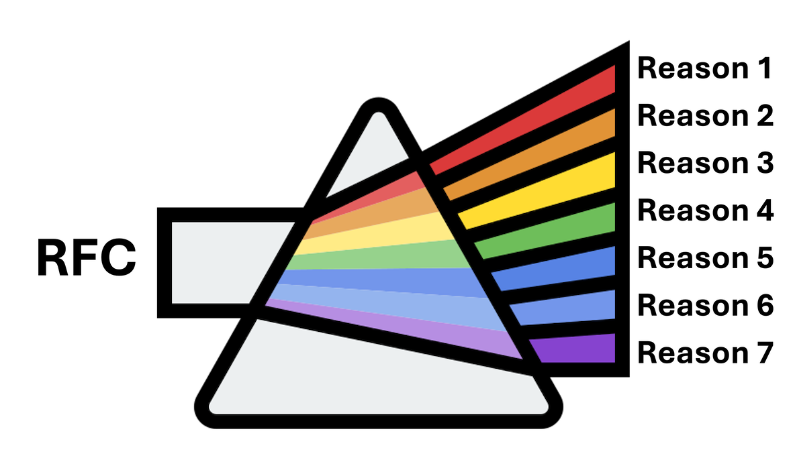
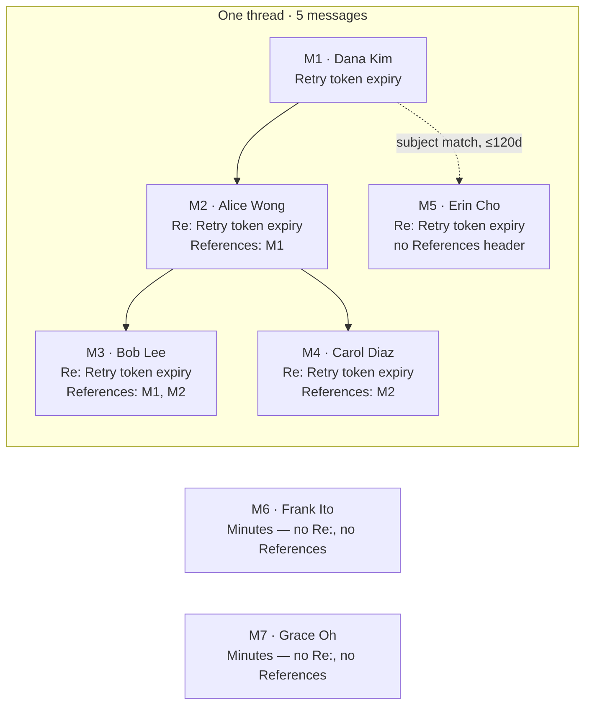
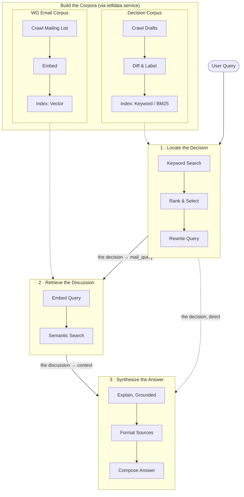

# Prism


<sup>*[Spectrum icons](https://www.flaticon.com/free-icons/spectrum)*</sup>

This repo is build upon [Dify](https://github.com/langgenius/dify), an open-source LLM app development platform, extended with a pipeline for importing IETF standards data (mailing lists, RFCs, internet-drafts, and working-group GitHub repos) into Dify knowledge bases for RAG.

For everything about Dify itself — install docs, general features, community, contributing — see the [upstream repository](https://github.com/langgenius/dify). This README only covers what's specific to this project.

## Background

Prism is based on the [Ph.D. project](https://folk.universitetetioslo.no/michawe/research/projects/rdr/index.html) of Jie Bian, extracting and explaining the design rationale behind RFC/Internet-Draft decisions from the discussion that produced them. See the [project page](https://folk.universitetetioslo.no/michawe/research/projects/rdr/index.html) for further research details, and [mwelzl/prism](https://github.com/mwelzl/prism) for the companion search-engine repository this fork feeds into.

## Quick start

> Before installing, make sure your machine meets the following minimum system requirements:
>
> - CPU >= 2 Core
> - RAM >= 4 GiB

The easiest way to start the server is through [Docker Compose](docker/docker-compose.yaml). Make sure [Docker](https://docs.docker.com/get-docker/) and [Docker Compose](https://docs.docker.com/compose/install/) are installed, then:

```bash
cd dify
cd docker
cp .env.example .env
docker compose up -d
```

Access the dashboard at [http://localhost/install](http://localhost/install) and start the initialization process.

## My additions

IETF standards work is scattered across mailing-list archives, an RFC index, draft revisions, and GitHub. There was no way to ask an LLM things like "what changed in this draft, and why did the working group decide that?" — answering that needs both the spec text *and* the mailing-list discussion behind each change, linked together. This project builds that pipeline on top of Dify's RAG stack.

### Ingestion

A Python 3.13 sidecar service (`tools/ietfdata_service/`, FastAPI) handles all IETF-specific data access, since the `ietfdata` library needs a newer Python than Dify's API runtime — the two talk over HTTP (`IETFDATA_SERVICE_URL`, internal-network-only, no host port). It exposes:

- **Mailing lists** — `GET /mailarchive/lists`, per-list sync status, and a background-thread `POST /sync`; the import endpoint itself (`POST /import/mailarchive`) supports boolean query parsing (`AND`/`OR`/quoted phrases) against subject/body, JSONL or mbox output, pagination or `fetch_all`, and dedups by `Message-ID` (IETF's IMAP double-delivers messages).
- **RFCs & drafts** — `GET /rfcs/suggestions` (autocomplete search that also builds each draft's full version history by cross-referencing the Datatracker's submission records — this is what backs the draft-evolution version tracking), format-availability probing (txt/html/pdf/xml), and bulk import by ID or by filter (since/until/stream/wg/status).
- **Text cleanup** — a front/back-matter stripper (`_extract_technical_body_text`) that removes RFC/I-D title pages, boilerplate, and page headers/footers from form-feed-paginated plaintext before anything gets chunked.

The sidecar's mailarchive output (JSONL) and mbox exports needed new extractors on Dify's side: `api/core/rag/extractor/jsonl_extractor.py` parses newline-delimited JSON (one record per line, `body`/`content` promoted to chunk text, every other field kept as metadata), registered for `.jsonl` alongside a plain-text `.mbox` fallback in `extract_processor.py`.

GitHub import (issues/PRs, async via Celery with progress tracking and resume-on-failure) is a separate, Dify-native path — `api/services/github_import_service.py` + `api/tasks/github_import_task.py` — with three interchangeable loader backends (raw GraphQL, LangChain's `GitHubIssuesLoader`, LlamaIndex's `GitHubRepositoryIssuesReader`), exporting one JSONL record per issue/PR.

### Conversation threading & text quality

Raw mailarchive messages are grouped into threads rather than indexed as isolated emails (`api/services/email_threading.py`), with configurable quote-removal (`api/services/email_quote_cleaning.py`) so replies don't drown the signal in repeated quoted text. Both have offline eval harnesses (`api/scripts/eval_threading.py`, `api/scripts/eval_quote_cleaning.py`) that sample real mbox messages, compare cleaning modes, and write side-by-side markdown reports — used to tune the cleaning heuristics against real archive data before trusting them in the ingestion path.


**Threading.** ~99% of replies carry `References`/`In-Reply-To` headers, grouped via union-find. The rest are joined only if the subject actually looks like a reply (`Re:`/`Fwd:`) and lands within 120 days of the earliest message with the same normalized subject — a plain subject never merges, so two unrelated postings titled "Minutes" stay two separate threads:



*(M6 and M7 share the exact subject text but get no edge at all — a bare "Minutes" is never a reply.)*

**Quote cleaning.** `clean_email_body()` decides per quote block whether anything follows it: nothing after → drop the whole block (the parent message is already its own chunk); new text after → keep a short attributed stub so the reply still has its referent. Signatures, mailman footers, and PGP blocks are truncated outright. `advanced` mode on a real inline reply:

```diff
 Agreed with Alice on the safety concern below.

-On Feb 3, 2026, at 14:02, Alice Wong <alice@example.com> wrote:
+[quoting Alice Wong]
 > I'm not sure this is safe. If the client retries after expiry we'd
 > silently drop valid tokens without any recoverable-error signal.

 But I don't think we need a MUST here — a SHOULD with rationale text
 covers it, and matches how we handled the amplification-limit case.

-- 
-Carol Diaz
-IETF QUIC WG
-_______________________________________________
-Quic mailing list -- quic@ietf.org
-To unsubscribe send an email to quic-leave@ietf.org
```

| mode | behavior |
|---|---|
| `none` | body indexed unchanged |
| `naive` | drops lines starting with `>` only — attribution, signature, and footer all stay |
| `advanced` | truncates signature/footer/PGP, keeps a stub only for quotes with new text after them |

See it rendered, with a fuller worked example → [Thread Reconstruction](https://claude.ai/code/artifact/361a7601-b238-4f08-b696-de2a04846c9e)

### Draft evolution & annotated RFCs

A section-level diff chain walks every revision of a draft and produces paragraph-level prose diffs (`change_type`, `from_rev`, `to_rev`, `section_id`), and the final RFC is annotated with per-section lineage (`first_seen_rev`, `last_changed_rev`, `change_count`) so retrieval can distinguish long-stable text from recently-changed text.

`api/scripts/link_evolution_to_threads.py` connects that diff data to discussion: for every section change, it uses the change text as a retrieval query against a mailarchive dataset and reports the best-matching threads, flagging whether each match falls inside or outside the revision's actual submission-date window (fetched from the sidecar). This is the offline tool that answers "which discussion actually caused this change?" — and the same idea, packaged as a live query-time flow, is the decision bot below.

### Pluggable chunking strategies

Stock Dify ships one splitter (recursive character splitting) plus a QA mode. This fork adds a real strategy system — not IETF-specific, it's now available to any dataset — spread across four files under `api/core/rag/splitter/`:

- **`chunk_strategy.py`** is the registry: a `ChunkStrategy` literal of 24 named strategies, grouped into a `StrategyCategory` enum (`CHARACTER`, `TOKEN`, `BOUNDARY`, `FRAMEWORK`) that determines which sizing inputs apply, plus lookup helpers for each strategy's provider and default separators.
- **10 custom strategies** (`recursive` [default], `paragraph`, `sentence`, `markdown`, `html`, `json`, `code`, `latex`, `token`, `semantic`) — `paragraph` and `semantic` are new splitters in `fixed_text_splitter.py`: `ParagraphSplitter` (blank-line boundaries, no size enforcement) and `SemanticTextSplitter` (groups sentences by embedding cosine similarity, falling back to NLTK/regex sentence tokenization, then to paragraph splitting if no embedding model is configured).
- **7 LlamaIndex-backed strategies** (`li_*`, `llamaindex_splitters.py`) and **7 LangChain-backed strategies** (`lc_*`, `langchain_splitters.py`) — thin adapters onto each framework's own node parsers/splitters (sentence, token, markdown/HTML header, code, semantic chunkers). Both import their framework lazily and raise a clear `pip install` hint if it's missing, so the module loads fine either way.

`index_processor_base.py`'s `_get_splitter()` was rewritten to dispatch on `StrategyCategory`: framework strategies go through a new `_get_framework_splitter()` factory; boundary strategies pick `SemanticTextSplitter`/`ParagraphSplitter`; character/token strategies keep the original splitter with strategy-specific separators instead of one hardcoded set. This flows end-to-end — `chunk_strategy` + a `strategy_params` dict live in `DatasetProcessRule.rules` (DB), the document-creation API, and a new provider/strategy selector plus a dynamically-rendered parameter form in `general-chunking-options.tsx` — and it applies to parent-child (hierarchical) mode too, not just flat chunking.

The one IETF-specific piece riding on top of this general system: `parent_child_index_processor.py` aligns child-chunk boundaries to `--- Message N | ... ---` markers for mailarchive thread records, so a child chunk never straddles two emails.

### "Decision → Discussion" chatflow (Prism)

The piece that actually answers *why*, published as a Dify workflow via `api/scripts/sync_decision_bot.py`.

**Why not a single corpus and a single retrieval pass.** "Why was this change made?" isn't one lookup, it's two, over two fundamentally different kinds of text — and neither one is served well by the retrieval method that suits the other:

- The **evolution corpus** is small, structured, exact: each entry is a tagged fact — *this section, this revision range, this change type, in this draft*. Keyword search is what actually finds the right one; folding it into a big vector index full of free-flowing prose would just dilute it with noise.
- The **mailing-list corpus** is the opposite — large, unstructured, paraphrase-heavy natural language, where the same argument gets restated a dozen different ways across a thread. That's exactly the case semantic search is for, and exactly the case keyword search handles badly.

One corpus with one retrieval pass would have to compromise on both. Splitting them also makes the two-hop shape of the actual question possible: you can't search for a decision's discussion until you know *which* decision, so the first stage's job is disambiguation, and the second stage's query is literally built from what the first stage found — not something a single pass could produce.



Current design is a single linear flow — `start → retrieve → pick decision → retrieve → explain → format sources → answer`:

1. The typed query retrieves the best-matching spec change from the evolution dataset (keyword-weighted).
2. A code node resolves the top candidate into a human-readable header (section, revision range, change type, draft) and blends the change text with the original query into a new search query — *not* a straight rewrite, a blend of both.
3. That blended query retrieves the mailing-list discussion behind that specific change (semantic search, via the fine-tuned embedding model below).
4. The LLM (`llama-3.3-70b-instruct` via OpenRouter, temp 0.3) is grounded in the retrieved discussion and forced into three fixed headings — **why the change was made**, **what the change says**, **alternatives/objections raised** — with retry-on-failure (2 retries, 8s backoff) since free-tier OpenRouter returns transient 429s under load.
5. Sources are deduped and listed with similarity scores; the other candidate changes are shown alongside the answer so a near-miss match is easy to notice and re-query.

An earlier iteration let the user pick a change from a dropdown instead of typing freely, and had a separate node for follow-up-question chips — both were tried and removed in favor of the simpler always-free-text design above.

The script itself also verifies its own deploys: after publishing the workflow via `AppDslService.import_app()`, it reloads the stored row from the DB and asserts the node IDs and opening statement actually match what was generated, since a prior `--app-id` refresh once reported success without persisting.

### Embedding & retrieval infrastructure

A custom embedding model (`RFC-DRAlign-QN`) fine-tuned for aligning RFC/draft text, quantized to GGUF and served via a host-level Ollama install (validated at cosine 0.985–0.9998 against the fp16 reference) — see [Local development](#local-development) below for how it's registered.

**Per-dataset keyword store.** Stock Dify's Economical (keyword-only) indexing mode only had Jieba, a TF-IDF-style overlap ranker. Migration `a1b2c3d4e5f6_add_keyword_store_to_datasets` adds a `datasets.keyword_store` column (default `'bm25'`), and `Keyword._init_keyword()` now prefers that per-dataset value over the old server-wide config. `api/core/rag/datasource/keyword/bm25/bm25.py` is a from-scratch `Bm25Keyword` implementation: it stores the full tokenized corpus in the existing keyword-table storage slot, tokenizes with a minimal regex + ~90-word stopword list (no NLP dependency), ranks with `rank_bm25.BM25Plus` computed per query, and guards concurrent index updates with a Redis lock. It's selectable per dataset via a radio control shown when Economical mode is chosen in the create-dataset wizard.

**Weaviate hardening.** Weaviate's hybrid/BM25 full-text search already existed in stock Dify — what this fork changed is correctness under the new chunking strategies above: chunk UUIDs are now derived from each chunk's own `doc_id` instead of a hash of its text, since identical short chunks (common with paragraph/semantic/framework splitting) were colliding and silently overwriting each other under the old content-hash scheme; metadata keys that would collide with Weaviate's own reserved properties (`id`, `vector`) are now guarded against; differently-named source fields (`message_id`/`messageId`, `source_url`/`link`, etc.) are canonicalized into a fixed set of display properties; and a new `get_by_ids()` method fetches chunks by ID for the metadata inspection below.

### Chunk metadata inspection

The console's chunk detail view can only show whatever fields stock Dify hardcodes. Two new endpoints — `GET .../segments/<id>` and `GET .../segments/<id>/child_chunks/<id>` — attach a `metadata` object built by `SegmentService.get_chunk_metadata()`: it tries the vector store's `get_by_ids()` first, falls back to regex-parsing a structured header line embedded in the chunk's own text, and for continuation chunks walks back through up to 20 preceding segments to find the nearest chunk that carries one.

The frontend renders whatever comes back generically — known fields (the draft-evolution lineage fields `from_rev`/`to_rev`/`section_id`/`change_type`/etc., and canonical email fields `url`/`subject`/`id`/`date`) get friendly labels; anything else falls back to an auto-generated, title-cased label. So new metadata the pipeline starts attaching later shows up in the UI without a frontend change — this is what makes draft-evolution lineage and thread provenance actually inspectable per chunk, not just present in the index.

### Import UI

A React import wizard (`web/app/components/datasets/create/ietf-importer/`) with WG-aware auto-fill — backed by a ~380-entry working-group → GitHub-repo mapping (`wg-repos.ts`) — and an I-D/RFC info card synced against the Datatracker (predecessors, replaces/replaced-by, published-as RFC).

### Exploratory / in progress

A couple of root-level scripts (`gh2csv_code.py`, `gh2csv_ids.py`) are an earlier, standalone exploration of the same "decision → discussion" idea applied to GitHub PRs instead of mailing-list threads — for each merged PR, aggregating its own comments plus the comments/reviews of every issue it closed into one record. Not wired into the app; kept as a reference for a possible PR-centric counterpart to the mailing-list chatflow. `WG-list(update).md` is the staging source used to refresh `wg-repos.ts` above.

This is still actively evolving — see the commit history on `feature/ietf-mailarchive-import` for the current state of the work.

## Local development

The quick-start above (`docker compose up -d` with the published images) is the fastest way to just run the app. Day-to-day development on this fork uses a different, more granular setup — everything lives in `dev/`:

- **`dev/setup`** — one-time bootstrap: copies the `.env.example` files (`api/`, `web/`, `docker/middleware.env.example`), then `uv sync --group dev` and `pnpm install`.
- **`dev/start-active-dev`** — the main hybrid loop: backend (`api worker worker_beat ietfdata_service weaviate sandbox ssrf_proxy plugin_daemon`) runs in Docker via `docker-compose.override.yaml`, which builds a local `dify-local-api:dev` image from `../api` instead of pulling `langgenius/dify-api`; the frontend runs natively (`pnpm dev`) for hot reload.
- **`dev/rebuild-backend`** — after backend code/dependency changes: clears the old `dify-local-api:dev` image and build cache, rebuilds `api` + `ietfdata_service`, force-recreates both, and tails their logs.
- **`dev/start-api`** / **`dev/start-web`** — fully native (no Docker) versions of each side, for working against `dev/start-docker-compose`'s middleware-only stack (Postgres/Redis/Weaviate).
- **`dev/set-vector-store <store>`** — patches `VECTOR_STORE` in `docker/.env` and rebuilds.

The `ietfdata_service` sidecar is always included in the Docker set (it's defined in the base `docker-compose.yaml`, not the override) and is reachable only on the internal network at `http://ietfdata_service:8010` — there's no host port for it.

**The embedding model has no compose service or env var at all.** `RFC-DRAlign-QN` is served by a host-level Ollama install, not a container: `dev/start-embedding-server` looks for the GGUF at `$HOME/Models/rfc-dralign-q8-pooled.gguf` (override with `RFC_DRALIGN_GGUF`), registers it with `ollama create rfc-dralign-q8` if not already present, and health-checks `http://localhost:11434/api/embed`. Dify itself is then pointed at it manually, once, via Settings → Model Provider → Ollama, with `base_url: http://host.docker.internal:11434` and model `rfc-dralign-q8` (4096 dims) — this step doesn't show up in any `.env` file, so it's easy to miss on a fresh machine.

## Advanced Setup

### Custom configurations

If you need to customize the configuration, refer to the comments in [.env.example](docker/.env.example) and update the corresponding values in your `.env` file. You may also need to adjust `docker-compose.yaml` (image versions, port mappings, volume mounts) for your environment. After changes, re-run `docker compose up -d`. Full list of environment variables [here](https://docs.dify.ai/getting-started/install-self-hosted/environments).

## License

This repository is licensed under the [Dify Open Source License](LICENSE), based on Apache 2.0 with additional conditions.
