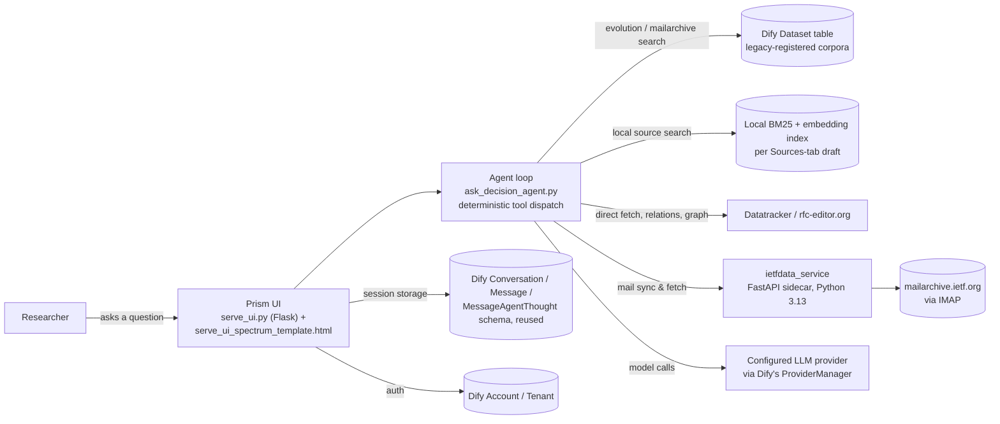

# Prism


<sup>*[Spectrum icons](https://www.flaticon.com/free-icons/spectrum)*</sup>

Prism is an AI research agent for IETF standards. Ask it why a protocol works the way it does — "why does DNSSEC use NSEC3 instead of NSEC?", "why is INIT_CWND set to 4?" — and it reads the actual draft revisions, the working-group mailing list, meeting minutes, and IESG review comments to answer, with every claim traced back to a real source you can open yourself.

It's built on top of [Dify](https://github.com/langgenius/dify) — this repo is a Dify fork, and Dify's account/session infrastructure and LLM provider configuration are what it's built on — but the agent, the retrieval pipeline, and the UI are custom. See [Relationship to Dify](#relationship-to-dify) below for exactly where the line is.

For everything about Dify itself — install docs, general features, community, contributing — see the [upstream repository](https://github.com/langgenius/dify). This README only covers what's specific to Prism.

## The problem

A published RFC tells you *what* a protocol does. It almost never tells you *why* — why one design was chosen over another, what problem motivated a change, what alternative was considered and rejected. That history lives in the discussion that produced the spec: mailing-list threads, meeting minutes, IESG ballot comments, spread across years and formats that don't jump out as "the same decision" to a keyword search, let alone to a model that's only been shown the spec text.

Spec text alone is not evidence of rationale, no matter how self-explanatory a diff looks. Answering "why" needs the discussion that produced the change, linked to the change itself.

## How it answers a question

Every answer follows the same two-hop process, enforced by the agent's own instructions ([`agent_skill.md`](api/scripts/agentic_rag/agent_skill.md) — the literal system prompt):

1. **What changed.** Search the draft-evolution corpus — tagged, section-level diffs between specific revisions — to pin down the exact change being asked about.
2. **Why it changed.** Search the working group's mailing-list archive for discussion of that specific change. If that's thin or empty, the agent doesn't stop: it tries differently-phrased queries, then meeting minutes, then the RFC's formal obsoletes/updates relations, then its wider topical family, before giving up on a source.

The answer is written under a fixed set of headings, each included only if the evidence actually supports it — no heading is ever written just to say "none found":

- **Decision** — the specific behavior or requirement actually adopted.
- **Rationale** — the problem or constraint that motivated it, traceable to specific retrieved messages.
- **Alternatives** — a genuinely different approach that was proposed and rejected, not the decision's own before/after text repackaged.
- **Evolution** — where the wording or behavior changed across revisions, distinct from *why*.
- **Uncertainty** — what can't be established from the available sources: an open question, a claim that doesn't trace to a specific message.

Every claim cites a real `[N]` evidence marker a tool actually returned — never a number invented while writing. Before finalizing, the agent calls its own `verify_answer` tool, which fact-checks the full draft against the retrieved evidence in a separate pass and flags anything unsupported or misclassified.

A real answer, start to finish (session: "Why we evolve from NSEC to NSEC3?"):

> NSEC3 evolved from NSEC because NSEC's signed "next name" chain lets anyone walk a signed zone and enumerate every name in it — turning DNSSEC into a machine for handing out zone contents — and because securing every insecure delegation in large delegation-centric zones was prohibitively expensive; NSEC3 addresses both, by hashing owner names and by adding an Opt-Out flag.
>
> **Decision** — NSEC3 defines a new RR type whose owner names are cryptographic hashes of the original owner names, prepended... [continues under Rationale, Alternatives, Evolution, Uncertainty, each claim cited to a specific mail thread, draft revision, or RFC section]

## Agent tools

The agent reasons over these 16 tools (defined in [`ask_decision_agent.py`](api/scripts/agentic_rag/ask_decision_agent.py)), called with deterministic dispatch rather than an open-ended function-calling loop:

| Tool | Does |
|---|---|
| `list_available_ietf_corpora` | Discovery — lists every draft this instance has data for, its WG, and its dataset IDs. Called first when the right dataset isn't already known. |
| `search_ietf_evolution_dataset` | Section-level diffs of draft revisions — the WHAT. |
| `search_ietf_mailarchive_dataset` | WG mailing-list discussion — the WHY. |
| `search_local_drafts_rfc` / `search_local_mailarchive` | Same WHAT/WHY split, for a draft added via the Sources tab that has no real Dify dataset behind it — BM25 over locally-downloaded text. |
| `fetch_ietf_draft_text` / `fetch_ietf_rfc_text` | Fetch a specific revision or the final RFC directly from ietf.org/rfc-editor.org and search it — for confirming exact wording or checking gaps in the evolution dataset. |
| `diff_ietf_draft_revisions` | An independent, `iddiff`-based second opinion on a diff, separate from the evolution dataset's own precomputed one. |
| `cite_iddiff_url` | Builds a clickable citation URL on IETF's own diff viewer, pointing straight at the changed hunk. |
| `search_wg_minutes` | Already-downloaded meeting minutes — some decisions are made live in a meeting, not on the list. |
| `get_rfc_relations` | A published RFC's obsoletes/updates graph via Datatracker — families like DNSSEC span many RFCs this way. |
| `find_related_rfc_family` | Topically-related RFCs when there's no formal obsoletes/updates relation at all, only shared citation and topic. |
| `get_iesg_ballot_comments` | DISCUSS/comment text from IESG standards-track review — a real, distinct venue from the mailing list. |
| `search_rfc_corpus_bm25` | BM25 keyword search over all ~9,930 published RFCs. |
| `find_similar_rfcs_by_meaning` | Semantic search over the same corpus, via a locally-served fine-tuned embedding model. |
| `add_local_source` | The one writing/costly tool — pulls and indexes every revision, the published RFC, and WG mail for a new draft/RFC in one call. |
| `verify_answer` | Fresh-eyes fact-check of the full draft answer against retrieved evidence. Mandatory before finalizing. |

## Product surface

A left-rail, document-first workspace (not a chat window bolted onto Dify's console):

- **Workspace** — the entry point: ask a question, or start from a document.
- **Documents** — look up an RFC or draft, read it section by section, jump straight into an investigation from a passage.
- **Investigations** — the core experience, three views on one research session:
  - *Findings* — the decision brief itself (Decision/Rationale/Alternatives/Evolution/Uncertainty), with an evidence panel for every citation.
  - *Decision history* — trace one phrase's exact wording across every draft revision it appears in ("within a document"), or a chronological map of every RFC the investigation actually touched, auto-populated from the session's own research activity ("across specifications") — never a manually curated timeline.
  - *Research activity* — a living evidence map: stable per-document nodes (not one box per tool call), a replayable timeline, and a "Selected source" panel showing the real retrieved excerpt behind every visit, not a category label.
- **RFC Graph** — the formal obsoletes/updates/citation graph, explorable from a global view or focused on one RFC's neighborhood.
- **Sources** — what's actually indexed: real Dify-dataset-backed corpora (built via the original WG-aware import wizard, `web/app/components/datasets/create/ietf-importer/` — full chunking, embedding, the whole Dify RAG pipeline) alongside locally-tracked sources (own pulls plus anything shared, indexed with local BM25 instead), with per-source ownership and opt-in sharing either way.
- **Archive coverage** — what Prism can and can't see for a given WG, derived from real trace data, not an aspirational list.
- **Usage** — token/cost accounting per session.

## Architecture



- **`api/scripts/agentic_rag/serve_ui.py`** is the actual product — a Flask app with its own routes for research, sessions, sources, documents, the RFC graph, coverage, usage, and a self-service signup/login flow with Prism's own branding (not Dify's console chrome).
- **`api/scripts/agentic_rag/ask_decision_agent.py`** is the agent loop: builds the 16-tool set, dispatches each call, streams live reasoning sentences to the UI, and runs the verify pass before returning.
- **`tools/ietfdata_service/`** is a standalone FastAPI sidecar, reached over the internal Docker network only. It exists because the [`ietfdata`](https://github.com/glasgow-ipl/ietfdata) library (for mailing-list IMAP access) requires Python 3.13+, while the main API runtime doesn't — isolating that dependency here instead of forcing the whole API onto a newer Python.
- **Local sources** (anything added via the Sources tab that isn't already a real Dify dataset) get their own BM25 — and optionally embedding — index, built and queried entirely outside Dify's dataset/chunking/vector-store pipeline.
- A small cached reverse-index, built once from rfc-editor.org's own `rfc-index.xml`, maps RFC ↔ publication year/title ↔ originating draft name — used to lay out Decision history's cross-specification map chronologically and to resolve a local source's RFC number, both without a live per-draft network call.

## Data model

Two tables, both deliberately separate from Dify's own schema rather than bolted onto it:

- **`IetfLocalSource`** (`draft_name`, `owner_account_id`, `shared`) — one row per locally-tracked draft/RFC. A local source is raw downloaded text on shared disk, not a Dify `Dataset`, so it has no tenant/permission fields to reuse the way a dataset does; ownership goes to whoever pulled it first, and sharing is opt-in, mirroring a dataset's own default-private behavior.
- **`IetfAgenticSessionShare`** (`conversation_id`, `shared`) — a side table layered on top of Dify's own `Conversation` row, since that's core schema this project otherwise doesn't touch.

## Relationship to Dify

The retrieval and reasoning layer is fully custom and has no real dependency on Dify's app builder or workflow engine at all. Dify's dataset/chunking/vector-store pipeline is a different story: it's not gone, just no longer the default path. A real `Dataset`-backed corpus is still buildable through Dify's own import wizard (now with an IETF-aware tab) for when full chunking and embedding is actually wanted, and the resulting rows are read directly — alongside every earlier corpus built the same way before this architecture existed. But the lightweight path added for this project (Sources tab → "Add a new draft") deliberately skips that pipeline entirely, going through `IetfLocalSource` and a local BM25 index instead — cheap enough to add a source on demand mid-investigation, not something that needs a full ingestion run first.

What's still genuinely, deliberately reused, not just "LLM configuration":

- **Auth** — `Account`/`Tenant`/`TenantAccountRole`. Self-service signup calls Dify's own `AccountService` directly rather than a hand-rolled path.
- **Session storage** — every investigation is a real Dify `Conversation`, with its turns as `Message`/`MessageAgentThought` rows, under one fixed synthetic `App` row created once for Prism. Dify's actual agent-execution pipeline is bypassed entirely; its conversation *schema and services* (`ConversationService`, `MessageService`) are reused wholesale for storage, listing, pagination, and feedback.
- **Background jobs** — one Celery task (building a local source's embedding index) runs on Dify's own worker/Redis queue, specifically so it survives a closed tab or a server restart.
- **LLM configuration** — `ProviderManager` lists and resolves configured models (`/api/models`), exactly the "which provider, which model" role you'd expect, and nothing more.

So: Dify's app-builder, workflow engine, and dataset/RAG pipeline are out of Prism's serving path for anything new. Its auth, conversation-storage schema, and task-queue infrastructure are still load-bearing, by design — reuse, not reinvention, of the parts that were never the point of this project to rebuild.

The docs under [`docs/prism/`](docs/prism/) (ingestion, chunking strategies, embedding/retrieval, conversation threading, the original Dify-chatflow "decision bot") describe the *predecessor* architecture — a Dify workflow app, not the custom agent above. That infrastructure isn't gone: the fine-tuned embedding model and the from-scratch BM25 store it documents still back `search_rfc_corpus_bm25`/`find_similar_rfcs_by_meaning`. But those docs describe how the early corpora and that supporting infrastructure were built, not how the current product answers a question — this README is that description now.

## Quick start

> Before installing, make sure your machine meets the following minimum system requirements:
>
> - CPU >= 2 Core
> - RAM >= 4 GiB

The easiest way to start the server is through [Docker Compose](docker/docker-compose.yaml). Make sure [Docker](https://docs.docker.com/get-docker/) and [Docker Compose](https://docs.docker.com/compose/install/) are installed, then:

```bash
cd dify
cd docker
cp .env.example .env
docker compose up -d
```

Prism is served at the domain root (`http://localhost/`); the underlying Dify console is still reachable as a fallback. `/spectrum` and `/classic` are friendly aliases for Prism's own two UI generations.

## Local development

The quick-start above (`docker compose up -d` with the published images) is the fastest way to just run the app. Day-to-day development on this fork uses a different, more granular setup — everything lives in `dev/`:

- **`dev/setup`** — one-time bootstrap: copies the `.env.example` files (`api/`, `web/`, `docker/middleware.env.example`), then `uv sync --group dev` and `pnpm install`.
- **`dev/start-active-dev`** — the main hybrid loop: backend (`api worker worker_beat ietfdata_service weaviate sandbox ssrf_proxy plugin_daemon`) runs in Docker via `docker-compose.override.yaml`, which builds a local `dify-local-api:dev` image from `../api` instead of pulling `langgenius/dify-api`; the frontend runs natively (`pnpm dev`) for hot reload.
- **`dev/rebuild-backend`** — after backend code/dependency changes: clears the old `dify-local-api:dev` image and build cache, rebuilds `api` + `ietfdata_service`, force-recreates both, and tails their logs.
- **`dev/start-api`** / **`dev/start-web`** — fully native (no Docker) versions of each side, for working against `dev/start-docker-compose`'s middleware-only stack (Postgres/Redis/Weaviate).
- **`dev/set-vector-store <store>`** — patches `VECTOR_STORE` in `docker/.env` and rebuilds.

The `ietfdata_service` sidecar is always included in the Docker set (it's defined in the base `docker-compose.yaml`, not the override) and is reachable only on the internal network at `http://ietfdata_service:8010` — there's no host port for it.

**The embedding model has no compose service or env var at all.** `RFC-DRAlign-QN` is served by a host-level Ollama install, not a container: `dev/start-embedding-server` looks for the GGUF at `$HOME/Models/rfc-dralign-q8-pooled.gguf` (override with `RFC_DRALIGN_GGUF`), registers it with `ollama create rfc-dralign-q8` if not already present, and health-checks `http://localhost:11434/api/embed`. Dify itself is then pointed at it manually, once, via Settings → Model Provider → Ollama, with `base_url: http://host.docker.internal:11434` and model `rfc-dralign-q8` (4096 dims) — this step doesn't show up in any `.env` file, so it's easy to miss on a fresh machine.

## Advanced setup

### Custom configurations

If you need to customize the configuration, refer to the comments in [.env.example](docker/.env.example) and update the corresponding values in your `.env` file. You may also need to adjust `docker-compose.yaml` (image versions, port mappings, volume mounts) for your environment. After changes, re-run `docker compose up -d`. Full list of environment variables [here](https://docs.dify.ai/getting-started/install-self-hosted/environments).

## Background

Prism is based on the [Ph.D. project](https://folk.universitetetioslo.no/michawe/research/projects/rdr/index.html) of Jie Bian, extracting and explaining the design rationale behind RFC/Internet-Draft decisions from the discussion that produced them. See the [project page](https://folk.universitetetioslo.no/michawe/research/projects/rdr/index.html) for further research details, and [mwelzl/prism](https://github.com/mwelzl/prism) for the companion search-engine repository this fork feeds into.

This is still actively evolving — see the commit history on `feature/ietf-mailarchive-import` for the current state of the work.

## License

This repository is licensed under the [Dify Open Source License](LICENSE), based on Apache 2.0 with additional conditions.
