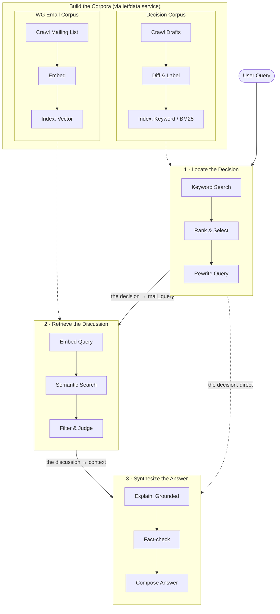
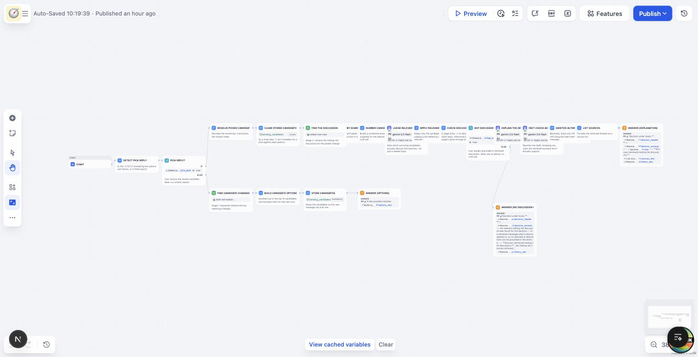

# "Decision → Discussion" chatflow

The piece that actually answers *why* a spec changed, published as a Dify workflow via `api/scripts/sync_decision_bot.py` (linear variant) and `api/scripts/sync_decision_bot_ux.py` (interactive variant, see [Two variants](#two-variants)).

## Draft evolution feeds it

A section-level diff chain walks every revision of a draft and produces paragraph-level prose diffs (`change_type`, `from_rev`, `to_rev`, `section_id`), and the final RFC is annotated with per-section lineage (`first_seen_rev`, `last_changed_rev`, `change_count`) so retrieval can distinguish long-stable text from recently-changed text.

`api/scripts/link_evolution_to_threads.py` connects that diff data to discussion: for every section change, it uses the change text as a retrieval query against a mailarchive dataset and reports the best-matching threads, flagging whether each match falls inside or outside the revision's actual submission-date window (fetched from the sidecar). This is the offline tool that answers "which discussion actually caused this change?" — and the same idea, packaged as a live query-time flow, is the chatflow below.

## Why not a single corpus and a single retrieval pass

"Why was this change made?" isn't one lookup, it's two, over two fundamentally different kinds of text — and neither one is served well by the retrieval method that suits the other:

- The **evolution corpus** is small, structured, exact: each entry is a tagged fact — *this section, this revision range, this change type, in this draft*. Keyword search is what actually finds the right one; folding it into a big vector index full of free-flowing prose would just dilute it with noise.
- The **mailing-list corpus** is the opposite — large, unstructured, paraphrase-heavy natural language, where the same argument gets restated a dozen different ways across a thread. That's exactly the case semantic search is for, and exactly the case keyword search handles badly.

One corpus with one retrieval pass would have to compromise on both. Splitting them also makes the two-hop shape of the actual question possible: you can't search for a decision's discussion until you know *which* decision, so the first stage's job is disambiguation, and the second stage's query is literally built from what the first stage found — not something a single pass could produce.



## Two variants

`sync_decision_bot.py` generates the original linear chatflow: one query, top-1 decision auto-picked, one answer. `sync_decision_bot_ux.py` generates an interactive variant that closes a real gap in that design — instead of always guessing `cands[0]` and asking the user to rephrase if it grabbed the wrong change, stage 1 shows up to the top 10 matching decisions and waits for a reply with a number. This doesn't reintroduce the old problem of a capped, pre-generated dropdown — retrieval still runs unconstrained on free text every turn, only the disambiguation step becomes interactive. The UX variant imports its prompts and pipeline logic directly from `sync_decision_bot.py` rather than duplicating them.

Both are regenerated the same way (inside the `api` container; import only updates the draft — Publish in Studio to go live):

```bash
docker exec -w /app/api docker-api-1 python scripts/sync_decision_bot_ux.py \
    --dataset <mailarchive-dataset-id> --evolution-dataset <evolution-dataset-id> \
    [--app-id <existing-app-id>]   # omit to create a new app instead of updating one in place
```

## Pipeline

The actual Studio canvas for the interactive (UX) variant, as currently deployed — the `[true]` branch (a pick reply) runs the retrieval → filter → judge → explain → fact-check → sanitize chain described below; the `[false]` branch (a fresh query) is the top-10 candidate picker from [Two variants](#two-variants):



1. **Locate the decision.** The typed query retrieves the best-matching spec change(s) from the evolution dataset (keyword-weighted). The linear variant auto-picks the top result; the UX variant shows up to 10 and waits for a pick.
2. **Build the follow-up query.** A code node resolves the picked candidate into a human-readable header (section, revision range, change type, draft) and blends the change text with the original query into the mailarchive search query. This is deliberately the *raw* decision text, not an extracted-keyword rewrite — an earlier version stripped the text down to just its identifier tokens (`INIT_CWND`, `MIN_CWND`, ...) on the theory that a tighter query would retrieve better, but testing showed the opposite: the fine-tuned embedding model (see [Embedding & retrieval infrastructure](embedding-and-retrieval.md)) does better with the full sentence than with a bag of stripped identifiers.
3. **Retrieve the discussion.** Semantic search against the mailarchive dataset, widened to top_k≈50–100. See [The dataset-level top_k trap](#the-dataset-level-top_k-trap) below for why this number matters more than it looks.
4. **Term-overlap filter.** A cheap, non-LLM pass drops retrieved threads that share none of the decision's identifier tokens with the candidate — administrative/procedural threads score deceptively well on topical closeness alone (see [Administrative notices](threading.md#administrative-notices-dont-belong-in-the-discussion-index)), and this filter is the first line of defense against that, before the more expensive judge step below even runs.
5. **LLM judge.** One batched call (not one call per candidate) reads up to 29 term-filtered excerpts and decides which ones *directly* discuss this decision — the same parameter/identifier and the same specific value or change — versus which are merely on the same broad topic. This step turned out to be load-bearing, not a nice-to-have: across tested decisions, the raw embedding-score rank of the eventually-correct thread ranged from #4 to #31, never reliably inside a naive top-5 or even top-10 cutoff. The judge is instructed to end its reply with a mandatory `ANSWER: <numbers>` (or `ANSWER: NONE`) line, and only digits *after* that marker are trusted — a chattier model reasoning through 29 excerpts can otherwise leak stray numbers (message IDs, dates) that look exactly like valid picks to a naive digit-scanner.
6. **Hard stop on nothing found.** If the judge finds zero relevant excerpts, the workflow routes straight to a fixed "no relevant mailing-list discussion was found" answer — no LLM call, no chance to improvise from empty context. This is deliberately upstream of the fact-check step below: better to not invite the failure mode than to clean it up after the fact. When the judge finds *something*, its exact picks are used as the context for the explain step — an earlier version padded a sparse judge result back out to a fixed size with additional (unconfirmed) top-scored candidates, on the theory that a thin context needed backup material; that reasoning didn't hold up (nothing in testing showed a genuinely thin context producing a worse answer) while padding back in unconfirmed candidates reopened exactly the false-grounding risk the judge exists to close.
7. **Explain, grounded.** The LLM writes the answer under three fixed headings:
   - **Rationale for the adopted approach** — traceable to specific retrieved messages, or an explicit "not clearly explained" if the discussion doesn't cover it.
   - **Alternatives considered** — only a genuinely different approach/value a message actually proposes as a considered option.
   - **Other relevant discussion** — corrections, open questions, or objections that are real and worth surfacing but aren't a proposed alternative. This third heading exists because forcing everything into the first two produced a confirmed misclassification: a person's *mistaken belief* about what the current value already was got framed as if they'd deliberately proposed that value as an alternative, once the retrieved thread was checked against what was actually said.
8. **Fact-check pass.** A second LLM call rewrites the draft answer against the same retrieved excerpts, checking two different things: whether each claim is actually *supported* (catches invented citations — a real person's name and message reference, attached to a claim they never made), and whether each Alternatives item is correctly *classified* (catches the mistaken-belief-as-alternative pattern above, moving and rewording it into "Other relevant discussion" instead of just deleting real content). If a whole section ends up with nothing supported after this pass, it's replaced with an honest one-line "not explained in the discussion" rather than left empty or padded.
9. **Mechanical sanitizer backstop.** A cheap, non-LLM phrase-matching pass still runs after the fact-check step, dropping any `Alternative:` line whose attribution literally names the draft/document/spec itself instead of a retrieved message. Kept as defense-in-depth even though the fact-check pass covers the same ground semantically — the two catch overlapping but not identical cases.
10. **Sources + other candidates.** Retrieved threads are deduped and listed (their own subject line preferred over the bare filename, so date ranges are visible at a glance); the other candidate decisions from stage 1 are shown alongside the answer so a near-miss match is easy to notice and re-query.

## Two bugs worth knowing about

### The dataset-level `top_k` trap

Dify's workflow-node `top_k` setting is silently ignored for single-dataset `HIGH_QUALITY` (vector) retrieval — the actual limit comes from the *dataset's own* stored `retrieval_model.top_k` default (a column on the `datasets` table), read in `core/rag/retrieval/dataset_retrieval.py`'s `_retriever()`. The node's configured `top_k` is only used as a `> 0` boolean gate, not the actual limit. This silently capped every mailarchive query at whatever the dataset was created with (as low as 3) regardless of what the workflow graph asked for. If retrieval on a dataset seems suspiciously thin no matter what the node config says, check:

```sql
SELECT retrieval_model->>'top_k' FROM datasets WHERE id = '<dataset-id>';
UPDATE datasets SET retrieval_model = jsonb_set(retrieval_model, '{top_k}', '100')
WHERE id = '<dataset-id>';
```

### A model's advertised context window isn't necessarily what you get

Chosen judge/explain models need enough context to read a batch of retrieved excerpts in one call. DeepSeek-chat's model card advertises 163,840 tokens — but routed through this project's OpenRouter account, which at the time was restricted to a single upstream provider (Novita), the *actual* usable context was 64,000 tokens, discovered when a 29-candidate batch hit exactly that ceiling and errored. The model card describes the model; the account's allowed-providers setting decides which infrastructure actually serves it, and that can silently cap the real number well below advertised.

## Model choice

The judge and explain steps both run on `google/gemini-2.5-flash` via OpenRouter (1,048,576-token context, actually delivered — routed through Google's own infrastructure rather than a shared aggregator). Both started on `llama-3.3-70b-instruct`; moved off it after finding it produce a confirmed fabricated citation (a specific person credited with a specific claim they never made, in a message that didn't exist in the retrieved set) and a visible mid-word generation glitch in a live answer. `gemini-2.5-flash` isn't immune to grounding mistakes either (see the fact-check pass above, built specifically because a Gemini-generated answer was caught crediting a real quote to the wrong kind of thing) — swapping models raised the quality floor, it didn't remove the need for the verification steps.

One example of the payoff: for a decision about why `GAIN` was set to 1, the discussion retrieved genuine IETF WG meeting minutes explaining exactly that — *"if delay measurement is completely broken, and zero queuing delay is always measured, this replicates the ramp up of a single TCP flow. This is why the value 1 was chosen originally, since we know that if we ramp up as with a single TCP flow, the world doesn't end."* That's real design rationale, accurately surfaced and accurately attributed — the thing this whole pipeline exists to find.

## Deploy self-check

The generator script verifies its own deploys: after publishing the workflow via `AppDslService.import_app()`, it reloads the stored row from the DB and asserts the node IDs and opening statement actually match what was generated, since a prior `--app-id` refresh once reported success without persisting.
