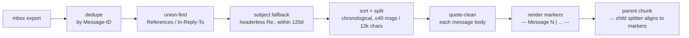
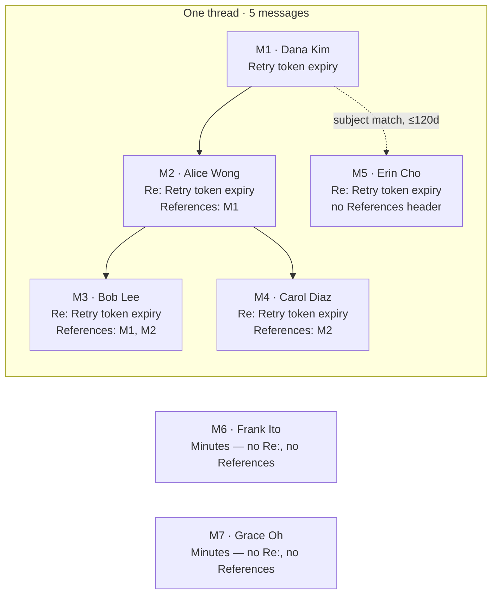

# Conversation threading & text quality

Raw mailarchive messages are grouped into threads rather than indexed as isolated emails (`api/services/email_threading.py`), with configurable quote-removal (`api/services/email_quote_cleaning.py`) so replies don't drown the signal in repeated quoted text. Both have offline eval harnesses (`api/scripts/eval_threading.py`, `api/scripts/eval_quote_cleaning.py`) that sample real mbox messages, compare cleaning modes, and write side-by-side markdown reports — used to tune the cleaning heuristics against real archive data before trusting them in the ingestion path.



## Threading

~99% of replies carry `References`/`In-Reply-To` headers, grouped via union-find. The rest are joined only if the subject actually looks like a reply (`Re:`/`Fwd:`) and lands within 120 days of the earliest message with the same normalized subject — a plain subject never merges, so two unrelated postings titled "Minutes" stay two separate threads:



*(M6 and M7 share the exact subject text but get no edge at all — a bare "Minutes" is never a reply.)*

### Mailman's `References` rewriting broke subject-pivoted threads

A message replying "New topic (WAS Re: Old topic)" is a genuine continuation of the *old* thread, just renamed — but Mailman rewrites `References` on some list configurations, so a message can carry a `References` header naming an ID that isn't actually any message in the archive. The original threading logic treated "has *any* `References` header" as "this message is linked to something," which let a dangling reference silently orphan the message into its own single-message thread instead of falling through to the subject-based fallback.

The fix: `linked` now means "my own `References` names an ID that's actually one of our messages" (`references & mids_set`, not just `bool(references)`), so a dangling reference correctly falls through to the subject fallback instead of stopping there. A `_WAS_RE_SUBJECT_RE` pattern plus `_subject_fallback_key()` also recognizes the WAS-Re pivot specifically, keying the fallback join on the *old* topic while leaving `normalize_subject()` (used for display) untouched — so the thread merges correctly but still displays under its current, renamed subject.

### Administrative notices don't belong in the discussion index

Procedural mailing-list traffic — `WG Action:`, `Document Action:`, `I-D Action:`, `Call for Papers`/`CFP`, `Last Call:`, `Summary: Call for Adoption/Comments` — was scoring deceptively well against a decision's formal spec text purely on topical closeness (shared boilerplate vocabulary), crowding out genuinely relevant but more narrowly-worded discussion. `_ADMINISTRATIVE_SUBJECT_RE` in `api/services/ietf_import_service.py` drops these at import time, matched against the subject only (never the body, to avoid false positives from a reply that merely quotes an administrative subject line). Deliberately **not** matched: `New Version Notification` (its first message often *is* the start of real discussion) and `minutes` (these can carry substantive rationale, e.g. a WG's live reasoning for a parameter choice — see the "the world doesn't end" example in [Decision → Discussion](decision-bot.md#model-choice)).

## Quote cleaning

`clean_email_body()` decides per quote block whether anything follows it: nothing after → drop the whole block (the parent message is already its own chunk); new text after → keep a short attributed stub so the reply still has its referent. Signatures, mailman footers, and PGP blocks are truncated outright. `advanced` mode on a real inline reply:

```diff
 Agreed with Alice on the safety concern below.

-On Feb 3, 2026, at 14:02, Alice Wong <alice@example.com> wrote:
+[quoting Alice Wong]
 > I'm not sure this is safe. If the client retries after expiry we'd
 > silently drop valid tokens without any recoverable-error signal.

 But I don't think we need a MUST here — a SHOULD with rationale text
 covers it, and matches how we handled the amplification-limit case.

-- 
-Carol Diaz
-IETF QUIC WG
-_______________________________________________
-Quic mailing list -- quic@ietf.org
-To unsubscribe send an email to quic-leave@ietf.org
```

| mode | behavior |
|---|---|
| `none` | body indexed unchanged |
| `naive` | drops lines starting with `>` only — attribution, signature, and footer all stay |
| `advanced` | truncates signature/footer/PGP, keeps a stub only for quotes with new text after them |

See it rendered, with a fuller worked example → [Thread Reconstruction](https://claude.ai/code/artifact/361a7601-b238-4f08-b696-de2a04846c9e)
